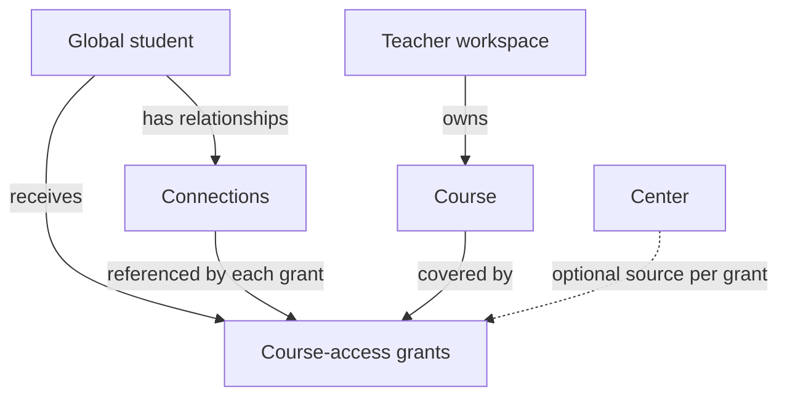
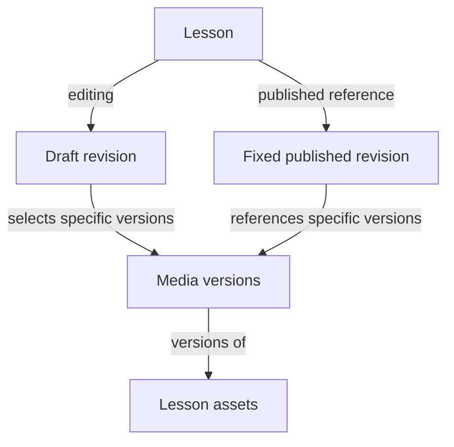

# First learning workflow domain model

This note presents the conceptual model agreed on 31 October 2026 for the first protected-learning workflow. The [resolved business-module decision](../../.scratch/ostadi-engineering/issues/02-business-modules-and-data.md#answer) records the decisions and their discussion history. The [approved source constraints](first-learning-prd-constraints.md) retain the PRD requirements. Exact tables, keys, APIs and security/media protocols remain dependent design work.

## Ownership and access

A student has one global profile. Teacher workspaces own their courses. Connections represent accepted student relationships; course-access grants separately authorize course/semester access for an academic cycle and dated period.

| Reference on a grant | Agreed meaning |
| --- | --- |
| Student | Existing shared student account |
| Teacher workspace and course | Course ownership must match the workspace |
| ConnectionId | Accepted student relationship through which this grant was issued |
| Optional CenterId | Empty for direct context; originating center for center context |
| Academic cycle and semester scope | The learning period and portion of the course covered |
| Access dates | Dated authorization under the PRD's Morocco-local inclusive-end rules |

The diagram expresses conceptual references, not a final physical schema or the complete authorization predicate. Exact connection participant storage and collaboration-history references remain open.

For the same student and teacher-owned course, direct access and access through Centers A, B and C may coexist, even with overlapping dates. Each grant references its own source connection. Do not enforce uniqueness on student/course alone. Exact duplicate active grants are prevented within the same authorizing context; nonidentical authorized overlaps remain possible. Losing one source does not remove another qualifying grant. Ending teacher–center collaboration follows the existing rule that already-issued grants survive until expiry unless separately revoked.

A unified course view and shared cycle/semester learning identity do not merge financial agreements or discussion contexts. The agreed fee is distinct from a confirmed payment, and neither payment recording nor its absence independently changes learning access.

## Lesson authoring and publication

Courses retain their approved chapter/lesson structure and immutable semester model. Lesson revisions hold content/resource selections; Media versions identify particular uploaded files with separate processing state.

The draft edit-version token is distinct from lesson revision identity and Media versions. A save checks and advances that token atomically. Stale saves conflict; the latest saved draft stays intact and recoverable unsaved edits are kept for review within session/security limits.

Publish targets the reviewed draft version, freezes its content/resource selections and switches the published reference with the required audit entry in one database transaction. Stale publication requires review; failed publication leaves the prior reference unchanged. Later editing uses a separate draft.

The diagrams do not choose exact revision/asset cardinalities, the treatment of unready attachments, a revision-retention period or rollback UI. Media must still pass its availability checks before exposure. Empty lessons remain allowed; the first protected-media demonstration nevertheless needs an eligible video or PDF. Quiz versioning remains governed separately.

## Writes and concurrent operations

| Operation | Agreed consistency boundary |
| --- | --- |
| Assign access to one student | Grant, associated agreed financial terms and audit evidence commit together or none do |
| Bulk assignment | Completed per-student assignments remain committed if other items fail |
| Retry the same assignment | Stable operation ID returns/reconciles the committed outcome without another business effect |
| Reuse operation ID with different terms | Conflict |
| Concurrent exact duplicate active assignment | Database boundary prevents a second assignment/fee agreement; report the duplicate as skipped |
| Save an outdated draft | Conflict; preserve the latest saved draft and recoverable unsaved work |
| Publish reviewed draft | Frozen revision, published-reference switch and audit evidence commit atomically |

These are design decisions, not executed tests. Precise constraints, direct-context null handling, state transitions, locks/isolation, in-flight requests and uncertain commit recovery remain required specifications. Any applicable notification/outbox work follows the approved rules; no new assignment-notification category is introduced.

## Actor scope and access coordination

Application receives server-built execution context and rechecks current authority for the action, resource and effective time. The target student's identity remains distinct from the authenticated acting account. Client-provided IDs select resources and must be validated.

For example, when Center A staff member Meryem assigns Ahmed to Saad's course, the actor is Meryem, the target student is Ahmed, the owning workspace is Saad's and the source context is Center A. Record the actual actor and affected scope in audit evidence.

A shared Application workflow coordinates module-owned checks before online lesson access/new media authorization. Evaluate current identity/device, all qualifying grants, workspace restrictions, publication and requested Media eligibility. Student reads resolve course ownership and consider every qualifying source. Existing student-finance independence, teacher-account versus workspace-block distinctions and disconnected-device limits continue to apply.

## Remaining design and verification

| Decision | Work carried forward |
| --- | --- |
| [Identity and tenant isolation](../../.scratch/ostadi-engineering/issues/04-identity-access-and-isolation.md) | Client/session/recovery protocols, context construction, relationship state transitions, worker authority, RLS and pooled connections |
| [Media and offline](../../.scratch/ostadi-engineering/issues/05-media-and-offline-contracts.md) | Exact media references, unready attachments, scanning/publication races, signed delivery and offline lifecycle |
| [First learning API](../../.scratch/ostadi-engineering/issues/06-first-learning-api-contracts.md) | Buildable schema, minimal financial linkage, operation/concurrency contracts, transaction implementation and errors |
| [First workflow verification](../../.scratch/ostadi-engineering/issues/09-first-workflow-qa.md) | Multi-center, denied access, partial bulk, retry/duplicate, stale draft and publication cases |
| [Finance contracts](../../.scratch/ostadi-engineering/issues/10-financial-and-reporting-rules.md) | Full financial agreement/renewal linkage, calculations, documents and reports |

No implementation or runtime evidence is established by this note. Full MVP day-one scope and release gates remain required.
